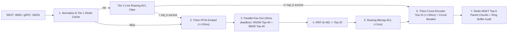

# Architecture — `rag-search-orchestrator`

`rag-search-orchestrator` is a low-latency **Go 1.26** retrieval orchestration microservice for the disaggregated RAG platform. It executes a deterministic, zero-allocation 6-stage retrieval cascade with native `uint32` Roaring Bitmap entitlement enforcement before any candidate reaches GPU reranking.

---

## 1. System Stack & SLOs

| Layer | Technology | Role & Operational Characteristics |
| :--- | :--- | :--- |
| **Language Runtime** | Go 1.26.0 (64-bit) | Low-latency concurrent network I/O, `GOMEMLIMIT=3600MiB`, `GOGC=100` |
| **Memory Discipline** | `sync.Pool` + Lock-Free Ring Buffer | Zero-alloc candidate slice reuse & non-blocking audit trace emission |
| **Inbound Transport** | gRPC (Protobuf v3 / HTTP/2) & REST | Multiplexed HTTP/2 gRPC (`:50051`, 30s TCP keepalive) + OpenAPI 3.1 HTTP (`:8080`) |
| **Entitlement ACL** | Native `uint32` Roaring Bitmaps | In-memory bitwise AND intersection ($< 1\text{ ms}$, zero UUID translation) |
| **Cache & Hydration** | Redis 7.2 Cluster | Tier 1 normalized query cache & pipelined `MGET` parent container hydration ($3\text{–}6\text{ ms}$) |
| **Dense & Sparse Search** | HNSW Read Replicas & BM25 Shards | Parallel unary gRPC fan-out with $20\text{ ms}$ `context.WithTimeout` deadline |
| **GPU Inference** | Triton Inference Server (gRPC) | FP16 query embedding ($\le 15\text{ ms}$) & dynamic-batched Cross-Encoder ($\le 30\text{ ms}$) |
| **Compliance Audit** | `rag-telemetry-audit-daemon` | Asynchronous HIPAA/SOC 2 provenance & access trace ingestion via ring buffer |
| **Containerization** | Distroless (`gcr.io/distroless/static:nonroot`) | Non-root UID `65532`, read-only rootfs, zero shell utilities |

- **Cold-Path SLO**: $\le 75\text{ ms}$ P99 end-to-end
- **Cache-Hit SLO**: $\le 8\text{ ms}$ P99
- **Throughput Target**: $5,000\text{ RPS}$ (14–32 autoscaled pods)

---

## 2. 6-Stage Retrieval Cascade



---

## 3. Clean 5-Layer Package Architecture

```text
rag-search-orchestrator/
├── cmd/search-orchestrator/        # Entry point, config/dotenv, pool warmup, graceful shutdown
├── api/
│   ├── openapi/openapi.yaml        # OpenAPI 3.1 REST specification
│   └── proto/v1/                   # Protobuf v3 gRPC service & message contracts
├── internal/
│   ├── domain/                     # Pure Go domain logic (zero network dependencies)
│   │   ├── entity/                 # QueryContext, SearchCandidate, FusedCandidate
│   │   ├── ranking/                # RRFEngine (k=60), CascadeFilter
│   │   ├── acl/                    # RoaringEvaluator (zero-alloc uint32 intersection)
│   │   └── repository/             # Domain ports (Dense, Sparse, Triton, Redis, Telemetry)
│   ├── application/                # Use cases & DTOs
│   │   ├── dto/                    # SearchRequest, SearchResponse, DiagnosticSearchResponse
│   │   └── usecase/                # ExecuteSearchUseCase, ExecuteDiagnosticSearchUseCase
│   ├── infrastructure/             # External adapters
│   │   ├── cache/redis/            # QueryTextCache (v2 binary codec) & ParentChunkReader
│   │   ├── search/dense/           # HNSW gRPC client (20ms deadline)
│   │   ├── search/sparse/          # Sharded BM25 gRPC client (20ms deadline)
│   │   ├── triton/                 # EmbeddingClient, RerankerClient, CircuitBreaker
│   │   └── telemetry/              # RingBufferEmitter & PrometheusMetrics
│   ├── transport/                  # Inbound gRPC & HTTP handlers/interceptors
│   └── config/                     # 12-factor config & sanitized dotenv loader
├── pkg/pool/                       # sync.Pool reusable candidate slice buffers
├── deployments/                    # Helm chart, Argo CD apps, Argo Rollouts, secret docs
├── scripts/                        # Env-to-Helm sync & Redis Cluster deployment scripts
└── test/                           # Unit, integration, performance, and chaos suites
```

---

## 4. Resilience, Security & Observability

- **Single-Index Fallback**: If either HNSW dense or BM25 sparse search times out ($20\text{ ms}$) or errors, RRF proceeds with candidates from the healthy modality.
- **Deterministic Circuit Breaker**: `internal/infrastructure/triton/circuit_breaker.go` trips when Triton Cross-Encoder P99 latency exceeds $35\text{ ms}$ or errors exceed $5\%$ (and bypasses reranking if remaining request `ctx.Deadline()` budget is $< 15\text{ ms}$), promoting ACL-filtered RRF candidates directly.
- **Pre-Inference ACL Isolation**: `RoaringEvaluator` intersects `caller_acl_bitmap` against candidate `uint32 doc_id` values in memory before candidates are sent to Triton Cross-Encoder GPU buffers.
- **Secured Logging**: All production logs use structured JSON (`log/slog`) and redact `Authorization` headers, bearer tokens, raw `caller_acl_bitmap` bytes, credentials, and local file paths, enforced in CI by `.github/scripts/audit_logging.go`.
- **Prometheus & Canary Gates**: Exposes `search_orchestrator_requests_total`, `search_orchestrator_latency_seconds`, `search_fanout_latency_seconds`, `search_fanout_stage_errors_total`, `search_circuit_breaker_tripped_total`, and `search_roaring_bitmap_eval_duration_seconds`, wired to `PrometheusRule` alerts and Argo Rollouts `AnalysisTemplate` gates.

For detailed API schemas and engineering invariants, see [`.ai/doc-api.md`](.ai/doc-api.md) and [`.ai/security.md`](.ai/security.md).
